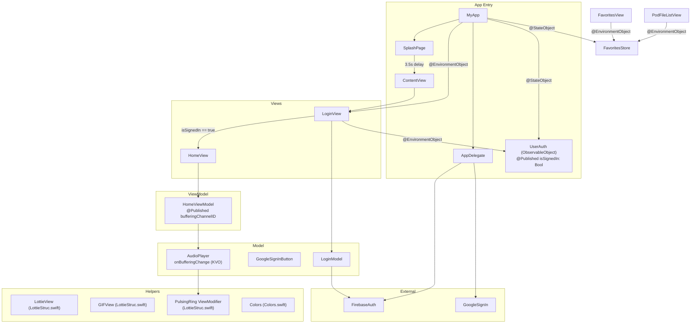

# CLAUDE.md

This file provides guidance to Claude Code (claude.ai/code) when working with code in this repository.

## Project Overview

iOS SwiftUI podcast player for Sveriges Radio (SR) — live radio streaming was removed (SR API terms, condition 2), built with Firebase Auth and Google Sign-In.

- **iOS**: 26.0+
- **Swift**: 6.0
- **App version**: 1.0

## Workflow

- Before every commit, verify no API keys or sensitive files are included.
- When creating a new component, always include its unit test in the same PR.
- After creating a component, update this file to reflect it in the architecture section.
- Keep the architecture diagram below up to date as a Mermaid diagram.
- **New files**: never create Swift files directly from the terminal or editor. Ask the user to create the file in Xcode first (so it is registered in `project.pbxproj`), then edit the content. This avoids manual `project.pbxproj` surgery.
- **Branch per task**: before starting any modification, create a git branch named after the task (e.g. `feature/user-profile`, `fix/background-audio`). Work on that branch and merge to `main` when done.

## Roadmap

### Note — live radio removed (2026-11-23)

SR API terms require written approval for linear channels, so `HomeViewModel`, `AudioPlayer`, the radio Home tab and the channel/now-playing API calls were removed. The app now has Poddar, Favoriter and Profil tabs. Entries below that mention channels, `AudioPlayer`, `HomeViewModel` or the Home tab describe features that no longer exist. The widget still shows P1 schedule info.

### Pending

- [ ] Review unused SPM transitive dependencies in `Package.resolved` (deferred)

### Done

- [x] Firebase Auth email sign-in
- [x] Google Sign-In button (URL handling)
- [x] `UserAuth` observable auth state injected via `@EnvironmentObject`
- [x] Lottie splash animation (`SplashPage`)
- [x] Color palette (`Colors.swift`)
- [x] `.gitignore` configured (blocks `GoogleService-Info.plist`, `xcuserdata`, etc.)
- [x] `AuthProtocol` + `MockAuth` dependency injection — live in `LoginModel.swift`, wired into `signInWithEmail`
- [x] Unit tests for `LoginModel` using `MockAuth` — no network required, all 3 tests pass
- [x] `HomeView` — `FeaturedCard`, `ChannelRow`, `TabView` UI (branch: HomeView)
- [x] SR API integration — `SRModels.swift` (Decodable + Microsoft date), `SRAPIClient.swift`, `AudioPlayer.swift` (AVPlayer live stream)
- [x] Background audio mode — `UIBackgroundModes: audio` in `New-SR-Player-Info.plist`
- [x] `HomeViewModel` tests — `SRAPIClientProtocol` + `AudioPlayerProtocol` DI; `MockSRAPIClient` + `MockAudioPlayer`; 9 unit tests, no network, all pass
- [x] Google Sign-In flow — `LoginModel.signInWithGoogle()` using GIDSignIn v7 `signIn(withPresenting:completion:)` API; `GoogleSignInButton` wired via `Coordinator` + `addTarget`; removed obsolete v5/v6 delegate from `AppDelegate`
- [x] Split `LoginModel.swift` — `UserAuth.swift` (`AuthProtocol`, `LiveAuth`, `UserAuth`), `GoogleSignInButton.swift`, `LoginModel.swift` (sign-in methods only)
- [x] `SplashPage` re-enabled as app entry point — `Headphone.gif` animation via `GIFView` (ImageIO, no new dependencies), 3.5s delay → `ContentView`
- [x] `GoogleService-Info.plist` added to project (not committed — blocked by `.gitignore`)
- [x] Google Sign-In session restore — `UserAuth` moved to `MyApp`; `restorePreviousSignIn` sets `isSignedIn = true` on relaunch
- [x] Pulsing ring buffering animation — `PulsingRing` ViewModifier (`LottieStruc.swift`); `AudioPlayer` KVO on `timeControlStatus`; `bufferingChannelID` in `HomeViewModel`; applied to `FeaturedCard` and `ChannelRow`
- [x] Launch screen — `LaunchScreen.storyboard` (project root); dark blue background `#0d1e2e`; app logo centered at 200×200pt via `LaunchLogo.imageset` (@1x/@2x/@3x); `LaunchBackground` color asset
- [x] Podcast tab ("Poddar") — `SRProgram` + `SRPodFile` models; `fetchPrograms()` + `fetchPodFiles(programID:)` in `SRAPIClientProtocol`; `PodcastViewModel` + `PodFileListViewModel` (own `AVPlayer`); `PodcastTab` + `PodFileListView` views; 5 unit tests, all pass
- [x] Favorites tab ("Favoriter") — `FavoritesStore` (`ObservableObject`, `UserDefaults` persistence via `JSONEncoder/JSONDecoder`); heart button on each podcast episode in `PodFileListView`; `FavoritesView` shows saved episodes with playback; `SRPodFile` + `MicrosoftDate` made `Codable`; heart buttons removed from radio channel rows; 6 unit tests, all pass
- [x] Podcast carousel — `PodcastCarousel` (`TabView` + `.page` style, swipe left/right); `PodcastCarouselCard` (full image background + gradient + text overlay); 5 random featured programs from `PodcastViewModel.featured`; `PodcastTab` refactored to `ScrollView + LazyVStack` (carousel on top, full list below); 5 unit tests, all pass
- [x] Launch screen color updated — `LaunchScreen.storyboard` background changed from dark blue `#0d1e2e` to teal `#33A6B3` to match the app icon background color
- [x] Connection error banner — `BannerStore` (`ObservableObject`, auto-dismiss after 3s, cancellable); `BannerView` + `BannerModifier`; applied once in `ContentView` via `.bannerOverlay()`; reusable from any view via `@EnvironmentObject`; 5 unit tests, all pass
- [x] Banner wired to real errors — `var banner: BannerStore?` on `HomeViewModel`, `PodcastViewModel`, `PodFileListViewModel`; `banner?.show(...)` in each `catch` block; views assign `vm.banner = banner` in `.task` before `load()`; 3 new unit tests (one per ViewModel), 36 total, all pass
- [x] Refactor ViewModels — `HomeViewModel`, `PodcastViewModel`, `PodFileListViewModel` extracted from View files into `Model/ViewModel/`; View files now contain only UI code
- [x] Background audio Control Center — `MPNowPlayingInfoCenter` (title, artist, artwork, isLiveStream) + `MPRemoteCommandCenter` (play/pause/toggle) in `AudioPlayer`; verified on real device
- [x] Animations — tab transitions (easeInOut 0.22s + symbolEffect bounce); carousel fade+drift entry; play/pause `symbolEffect(.replace)` + `PlayPulseButtonStyle` (scale 0.82); SplashPage→HomeView fade+scale(0.96) 0.5s; staggered list rows (spring delay 70ms/row)
- [x] `SplashPage` transition — ZStack swap; splash `.transition(.opacity)`; ContentView `.transition(.opacity.combined(with: .scale(0.96)))`; `withAnimation(.easeInOut(duration: 0.5))`
- [x] Profile page — `ProfileView.swift`; reads from `Auth.auth().currentUser` (Firebase) with fallback to `GIDSignIn.sharedInstance.currentUser?.profile` (Google); shows avatar (photo or initials circle), name, email, favorites count, sign-out button; anonymous users shown as "Gäst"
- [x] `UserAuth.signOut()` — calls `Auth.auth().signOut()` + `GIDSignIn.sharedInstance.signOut()` (guarded by `currentUser != nil`); sets `isSignedIn = false`
- [x] Anonymous login — `LoginModel.signInAnonymously()` via `Auth.auth().signInAnonymously()`; "Fortsätt som gäst" button in `LoginView`; `ProfileView` detects `isAnonymous` and shows "Gäst"
- [x] `GIDClientID` added to `New-SR-Player-Info.plist` — required by GIDSignIn v7 for sign-out without active configuration error
- [x] Equalizer animation — `EqualizerView` (3 bars, varying heights/durations, `repeatForever`); shown in `FeaturedCard` next to channel name and in `ChannelRow` between text and spacer when `isPlaying == true`
- [x] Google Analytics — `FirebaseAnalytics` linked to target; `Analytics+Events.swift` typed extension; events: `radio_channel_play`, `podcast_episode_play`, `favorite_toggle`, `login` (email/google/anonymous)
- [x] Home screen widget — `SRWidget` extension (WidgetKit); small widget showing P1 current program title, time range, and program image as full background with gradient overlay; `TimelineProvider` fetches channel color + schedule + image in parallel; refreshes every 30 min; tap opens the app via `.widgetURL`
- [x] Natural Language search — `ProgramSearchService` (`NLTokenizer` with `.swedish`); Swedish-aware tokenization + diacritic-insensitive matching; `.searchable()` in `PodcastTab`; search combines with category filter
- [x] API-driven category filter — `SRProgramCategory` added to `SRProgram` model; `programcategory` field decoded from SR API; horizontal chip bar in `PodcastTab` showing only categories present in loaded programs; chips toggle filter; `availableCategories` computed from loaded data
- [x] Language detection badge — `NLLanguageRecognizer` in `ProgramSearchService.detectedLanguage(for:)`; detects non-Swedish programs (confidence ≥ 0.70, min 15 chars); shows localized language name in Swedish (e.g. "Finska", "Arabiska") as a blue capsule badge in `PodcastRow`; results cached in `PodcastViewModel.languageCache` after `load()`
- [x] Now-playing music — `SRSong` model (`SRPlaylistResponse` + `SRPlaylist`); `fetchNowPlayingSong(channelID:)` calls `/playlists/rightnow`; `HomeViewModel.nowPlayingSong: [Int: SRSong]` fetched in `load()`; `FeaturedCard` shows `♪ Artist — Title` (white) when music plays, falls back to episode description; `ChannelRow` shows `♪ Artist — Title` in channel color as extra line below tagline

## Architecture

MVVM pattern with SOLID principles to maximize testability.



### File structure

```text
New_SR_Player/
├── New_SR_PlayerApp.swift       # @main — MyApp; owns @StateObject UserAuth + FavoritesStore + BannerStore; SplashPage as entry point
├── New-SR-Player-Info.plist     # UIBackgroundModes: audio; GIDClientID; Google Sign-In URL scheme
├── LaunchScreen.storyboard      # Launch screen — teal bg (#33A6B3) + LaunchLogo centered 200×200pt
├── Model/
│   ├── Login/
│   │   ├── AppDelegate.swift        # FirebaseApp.configure(), Google URL handling
│   │   ├── UserAuth.swift           # AuthProtocol, LiveAuth, UserAuth (ObservableObject) + signOut()
│   │   ├── GoogleSignInButton.swift # GoogleSignInButton (UIViewRepresentable)
│   │   └── LoginModel.swift         # LoginModel — signInWithEmail + signInWithGoogle + signInAnonymously
│   ├── ViewModel/
│   │   ├── HomeViewModel.swift      # HomeViewModel — channels, now playing, playback, väder
│   │   ├── PodcastViewModel.swift   # PodcastViewModel — programs, featured carousel
│   │   └── PodFileListViewModel.swift # PodFileListViewModel — episode list + AVPlayer playback
│   ├── FavoritesStore.swift         # FavoritesStore (ObservableObject) — persists [SRPodFile] via JSONEncoder + UserDefaults
│   └── Player/
│       ├── SRModels.swift           # SRChannel, SRScheduleEpisode, SRPodFile, MicrosoftDate (Codable)
│       ├── SRAPIClient.swift        # SRAPIClientProtocol + SRAPIClient (async/await, SR public API)
│       └── AudioPlayer.swift        # AudioPlayerProtocol + AudioPlayer (AVPlayer + KVO buffering + MPNowPlayingInfoCenter + MPRemoteCommandCenter)
├── Views/
│   ├── ContentView.swift        # @EnvironmentObject UserAuth; renders HomeView + bannerOverlay
│   ├── LoginView.swift          # Email/password + Google Sign-In + "Fortsätt som gäst" (anonymous)
│   ├── HomeView.swift           # FeaturedCard + ChannelRow + VäderRow + HomeTab + CustomTabBar + HomeView (UI only)
│   ├── FavoritesView.swift      # Shows saved podcast episodes; playback via PodFileListViewModel
│   ├── PodcastView.swift        # PodcastTab + PodcastCarousel + CarouselEntryModifier + PodcastCarouselCard + PodFileListView + PodFileRow (UI only)
│   ├── ProfileView.swift        # User profile — avatar, name, email, favorites count, sign-out button; anonymous-aware
│   └── SplashPage.swift         # Headphone.gif via GIFView, 3.5s delay → ContentView with fade+scale transition
└── Helpers/
    ├── Colors.swift             # Color palette + Color(hex:) + SRChannel.swiftColor/sfSymbol extensions
    ├── LottieStruc.swift        # LottieView, GIFView (ImageIO), PulsingRing ViewModifier, PlayPulseButtonStyle
    ├── BannerStore.swift        # BannerStore (ObservableObject), BannerView, BannerModifier, View.bannerOverlay()
    └── ProgramSearchService.swift # NLTokenizer (Swedish search) + NLLanguageRecognizer (non-Swedish badge detection)
SRWidget/                        # Widget extension target
├── SRWidget.swift               # ChannelEntry + SRWidgetProvider + SRWidgetEntryView + SRWidget (systemSmall)
├── SRWidgetBundle.swift         # @main WidgetBundle — registers SRWidget
└── SRWidgetControl.swift        # ControlWidget stub (generated by Xcode, not used)
```

### Key components

- **`UserAuth`** (`ObservableObject`, in `UserAuth.swift`) — single source of truth for auth state (`isSignedIn`). Created in `MyApp` as `@StateObject` and injected via `@EnvironmentObject` into the entire view tree. `signOut()` calls `Auth.auth().signOut()` + `GIDSignIn.sharedInstance.signOut()` (guarded) and sets `isSignedIn = false`.
- **`LoginModel`** — plain class (no `ObservableObject`) that wraps Firebase Auth calls: `signInWithEmail`, `signInWithGoogle`, `signInAnonymously`. Passed as a parameter to `LoginView`.
- **`ProfileView`** — reads user data from `Auth.auth().currentUser` (Firebase) with fallback to `GIDSignIn.sharedInstance.currentUser?.profile` (Google). Detects `isAnonymous` and shows "Gäst" with initial "G". Displays avatar (photo URL or initials circle), name, email, favorites count from `FavoritesStore`, and a destructive "Logga ut" button.
- **`GoogleSignInButton`** (`UIViewRepresentable`, in `GoogleSignInButton.swift`) — wraps `GIDSignInButton` for use in SwiftUI.
- **`AppDelegate`** — handles `FirebaseApp.configure()` on launch and forwards Google Sign-In URLs via `GIDSignIn.sharedInstance.handle(url)`.
- **`HomeViewModel`** (`@MainActor ObservableObject`, in `HomeView.swift`) — fetches SR channels and now-playing via `SRAPIClientProtocol`; controls playback via `AudioPlayerProtocol`; publishes `bufferingChannelID` updated via `onBufferingChange` callback from `AudioPlayer`. Both injected via `init` for testability.
- **`SRAPIClient`** — struct conforming to `SRAPIClientProtocol`; fetches from `https://api.sr.se/api/v2`; filters to channels P1 (132), P2 Musik (163), P3 (164), P4 Plus (4951).
- **`AudioPlayer`** — `final class` conforming to `AudioPlayerProtocol`; wraps `AVPlayer` for live MP3 streaming; configures `AVAudioSession` for background playback; uses KVO on `timeControlStatus` to detect buffering and fires `onBufferingChange` callback. Sets `MPNowPlayingInfoCenter` (title, artist, artwork, `isLiveStream`, `playbackRate`) and registers `MPRemoteCommandCenter` handlers for play, pause, and toggle.
- **`FavoritesStore`** (`ObservableObject`, in `FavoritesStore.swift`) — stores `[SRPodFile]` as `@Published`; persists via `JSONEncoder`/`JSONDecoder` to `UserDefaults`; exposes `toggle(episode:)` and `isFavorite(id:)`. Created in `MyApp` as `@StateObject` and injected via `@EnvironmentObject` into `PodFileListView` and `FavoritesView`.
- **`FavoritesView`** — reads episodes directly from `FavoritesStore.favorites` (no API call); uses `PodFileListViewModel` for playback; reuses `PodFileRow` for each episode row.
- **`PodFileRow`** — internal (not private); shows title, duration, heart button and play button; both buttons use `.buttonStyle(.plain)` to prevent tap conflicts inside `List`.
- **`PodcastCarouselCard`** — private view; full-width image background with `LinearGradient` overlay; program name and description in white text at bottom-left; clipped to `RoundedRectangle(cornerRadius: 20)`.
- **`PodcastCarousel`** — private view; `TabView` with `.tabViewStyle(.page(indexDisplayMode: .always))`; each card is a `NavigationLink` to `PodFileListView`; height 230pt; `PodcastViewModel.featured` supplies 5 random programs.
- **`ProgramSearchService`** (`struct`, `Helpers/ProgramSearchService.swift`) — uses `NLTokenizer` (`.swedish`) for word-boundary-aware search across program name + description; `filter(_:query:)` normalizes diacritics and tokenizes the query. Also uses `NLLanguageRecognizer` in `detectedLanguage(for:)`: processes name + description, returns the Swedish-localized language name (e.g. "finska") when a non-Swedish language is detected with confidence ≥ 0.70.
- **`SRProgramCategory`** (`Decodable, Identifiable, Equatable`, in `SRModels.swift`) — decoded from `programcategory` field in the SR API response; `id: Int` + `name: String`. `PodcastViewModel.availableCategories` derives the unique sorted list from loaded programs. Filter chip taps set `selectedCategory` on the ViewModel; `filtered` applies both search and category filter.

### Auth flow

`MyApp` (owns `UserAuth`) → injects via `@EnvironmentObject` → `LoginView` shows `HomeView` when `userAuth.isSignedIn == true`.

Three sign-in paths, all set `isSignedIn = true` on success:

- **Email/password** — `LoginModel.signInWithEmail` via `Auth.auth().signIn`
- **Google** — `LoginModel.signInWithGoogle` via `GIDSignIn.sharedInstance.signIn(withPresenting:)`
- **Anonymous** — `LoginModel.signInAnonymously` via `Auth.auth().signInAnonymously()`; shown as "Fortsätt som gäst" in `LoginView`

On app relaunch, `restorePreviousSignIn` in `MyApp.onAppear` restores an existing Google session silently. Sign-out via `UserAuth.signOut()` calls both Firebase and Google sign-out and sets `isSignedIn = false`, returning the user to `LoginView`.

### Radio flow

`HomeTab` calls `vm.load()` on appear → `SRAPIClient.fetchChannels()` returns filtered SR channels → `SRAPIClient.fetchNowPlaying(channelID:)` fetches the current schedule episode per channel → UI renders `FeaturedCard` (first channel) + `ChannelRow` list. Tap play → `AudioPlayer` streams the channel's `liveaudio.url` via `AVPlayer` → KVO on `timeControlStatus` fires `onBufferingChange` → `HomeViewModel` updates `bufferingChannelID` → `PulsingRing` animation appears on the button while buffering, disappears when playback starts.

### Helpers

- **`LottieView`** (`UIViewRepresentable`, `LottieStruc.swift`) — wraps `LottieAnimationView`, loops animation.
- **`GIFView`** (`UIViewRepresentable`, `LottieStruc.swift`) — decodes GIF frames via `ImageIO` (no extra dependencies) and plays them in a `UIImageView`. Used in `SplashPage` with `Headphone.gif`.
- **`PulsingRing`** (`ViewModifier`, `LottieStruc.swift`) — two concentric rings that expand and fade in a loop. Applied via `View.pulsingRing(isActive:color:)`. Used on play buttons in `FeaturedCard` (white) and `ChannelRow` (channel color).
- **`PlayPulseButtonStyle`** (`ButtonStyle`, `LottieStruc.swift`) — scales button to 0.82 on press with a spring bounce. Applied via `.buttonStyle(.playPulse)` on all play/pause buttons. Combined with `.contentTransition(.symbolEffect(.replace))` on the icon image for smooth play↔pause morphing.
- **`CarouselEntryModifier`** (`ViewModifier`, `PodcastView.swift`) — combines `offset(y:)` and `opacity` for a custom transition. Used as `.transition(.modifier(active:identity:))` on `PodcastCarousel` to produce a fade+drift-up entrance when data loads.
- **`Colors.swift`** — extends `SwiftUI.Color` with named palette constants:
  - `brown_light_p1`, `gray_light_p2`, `gray_p3`, `green_light_p4`, `green_p5`, `orange_light_p6`, `red_dark_p6`
- **`LaunchScreen.storyboard`** (project root) — UIKit launch screen; teal background (`#33A6B3`, matches app icon background); `LaunchLogo` image centered at 200×200pt via Auto Layout. `LaunchLogo.imageset` in `Assets.xcassets` provides @1x/2x/3x PNGs resized from the app icon. `LaunchBackground.colorset` provides the background color.
- **`BannerStore`** (`ObservableObject`, in `BannerStore.swift`) — shows a red slide-in banner at the top of the screen. `show(_ message:duration:)` sets the message and auto-dismisses after `duration` seconds (default 3). `dismiss()` hides it immediately. Created in `MyApp` as `@StateObject` and injected via `@EnvironmentObject`. Applied once in `ContentView` via `.bannerOverlay()` so it covers all tabs.

### SOLID / testability

Two DI patterns in the codebase:

- **Auth**: `AuthProtocol` / `LiveAuth` in `LoginModel.swift`. `LoginModel.signInWithEmail` accepts `auth: AuthProtocol` (defaults to `LiveAuth()`). Tests use `MockAuth`.
- **Radio**: `SRAPIClientProtocol` in `SRAPIClient.swift`; `AudioPlayerProtocol` in `AudioPlayer.swift`. `HomeViewModel.init(apiClient:audioPlayer:)` defaults to live implementations. Tests use `MockSRAPIClient` + `MockAudioPlayer` — no network, no `AVPlayer`.

## Build & Test Commands

Build for simulator:

```bash
xcodebuild -project New_SR_Player.xcodeproj -scheme New_SR_Player -sdk iphonesimulator build
```

Run all tests:

```bash
xcodebuild test -project New_SR_Player.xcodeproj -scheme New_SR_Player -destination 'platform=iOS Simulator,name=iPhone 17'
```

Run a single test:

```bash
xcodebuild test -project New_SR_Player.xcodeproj -scheme New_SR_Player \
  -destination 'platform=iOS Simulator,name=iPhone 17' \
  -only-testing:New_SR_PlayerTests/New_SR_PlayerTests/testSignInWithEmail
```

### Simulators

Default simulator for all test runs: **iPhone 17**.

Available iOS simulators on this machine:

| Simulator | Notes |
| --------- | ----- |
| iPhone 17 | **Default** |
| iPhone 17 Pro | |
| iPhone 17 Pro Max | |
| iPhone 17e | |

Always use `iPhone 17` unless a test specifically requires a different device.

## Dependencies (Swift Package Manager)

- `firebase-ios-sdk` 10.24.0 — `FirebaseAuth` + `FirebaseAnalytics`
- `googlesignin-ios` 7.1.0 — `GoogleSignIn` + `GoogleSignInSwift`
- `lottie-ios` 4.4.1

## Tests

| File | Class | Test | Type | Notes |
| ---- | ----- | ---- | ---- | ----- |
| `New_SR_PlayerTests.swift` | `New_SR_PlayerTests` | `testSignInWithEmail_callsAuth` | Unit | Verifies `MockAuth.signIn` is called |
| `New_SR_PlayerTests.swift` | `New_SR_PlayerTests` | `testSignInWithEmail_success_setsIsSignedIn` | Unit | Verifies `userAuth.isSignedIn = true` on success |
| `New_SR_PlayerTests.swift` | `New_SR_PlayerTests` | `testSignInWithEmail_failure_doesNotSetIsSignedIn` | Unit | Verifies `isSignedIn` stays false on error |
| `HomeViewModelTests.swift` | `HomeViewModelTests` | `testLoad_populatesChannels` | Unit | `load()` fills `channels` from mock client |
| `HomeViewModelTests.swift` | `HomeViewModelTests` | `testLoad_setsIsLoadingFalseWhenDone` | Unit | `isLoading` resets to false after `load()` |
| `HomeViewModelTests.swift` | `HomeViewModelTests` | `testLoad_populatesNowPlaying` | Unit | `nowPlaying[id]` set from mock episode |
| `HomeViewModelTests.swift` | `HomeViewModelTests` | `testLoad_networkError_channelsRemainEmpty` | Unit | Error path: channels empty, isLoading false |
| `HomeViewModelTests.swift` | `HomeViewModelTests` | `testLoad_networkError_showsBanner` | Unit | Network error triggers `banner.show()` |
| `HomeViewModelTests.swift` | `HomeViewModelTests` | `testTogglePlay_setsPlayingChannelID` | Unit | First toggle sets `playingChannelID` |
| `HomeViewModelTests.swift` | `HomeViewModelTests` | `testTogglePlay_sameID_stopsPlayback` | Unit | Second toggle on same ID → nil |
| `HomeViewModelTests.swift` | `HomeViewModelTests` | `testTogglePlay_unknownID_doesNothing` | Unit | Unknown ID → no-op, mock not called |
| `HomeViewModelTests.swift` | `HomeViewModelTests` | `testTagline_usesNowPlayingTitle` | Unit | Returns episode title when available |
| `HomeViewModelTests.swift` | `HomeViewModelTests` | `testTagline_fallsBackToChannelTagline` | Unit | Falls back to `channel.tagline` when no episode |
| `PodcastViewModelTests.swift` | `PodcastViewModelTests` | `testLoad_populatesPrograms` | Unit | `load()` fills `programs` from mock client |
| `PodcastViewModelTests.swift` | `PodcastViewModelTests` | `testLoad_setsIsLoadingFalseWhenDone` | Unit | `isLoading` resets to false after `load()` |
| `PodcastViewModelTests.swift` | `PodcastViewModelTests` | `testLoad_networkError_programsRemainEmpty` | Unit | Error path: programs empty, errorMessage set |
| `PodcastViewModelTests.swift` | `PodcastViewModelTests` | `testLoad_networkError_showsBanner` | Unit | Network error triggers `banner.show()` in PodcastViewModel |
| `PodcastViewModelTests.swift` | `PodcastViewModelTests` | `testPodFileListLoad_populatesPodFiles` | Unit | `load(programID:)` fills `podFiles` from mock |
| `PodcastViewModelTests.swift` | `PodcastViewModelTests` | `testPodFileListLoad_setsIsLoadingFalseWhenDone` | Unit | `isLoading` resets to false after episode load |
| `PodcastViewModelTests.swift` | `PodcastViewModelTests` | `testPodFileListLoad_networkError_showsBanner` | Unit | Network error triggers `banner.show()` in PodFileListViewModel |
| `PodcastViewModelTests.swift` | `PodcastViewModelTests` | `testFeatured_hasAtMostFivePrograms` | Unit | `featured` nunca supera 5 elementos |
| `PodcastViewModelTests.swift` | `PodcastViewModelTests` | `testFeatured_hasFivePrograms_whenEnoughExist` | Unit | `featured` tiene exactamente 5 cuando hay ≥5 programas |
| `PodcastViewModelTests.swift` | `PodcastViewModelTests` | `testFeatured_isSubsetOfPrograms` | Unit | Todos los elementos de `featured` están en `programs` |
| `PodcastViewModelTests.swift` | `PodcastViewModelTests` | `testFeatured_containsAllPrograms_whenFewerThanFive` | Unit | Si hay <5 programas, `featured` los contiene todos |
| `PodcastViewModelTests.swift` | `PodcastViewModelTests` | `testFeatured_isEmpty_whenLoadFails` | Unit | `featured` queda vacío si falla la red |
| `BannerStoreTests.swift` | `BannerStoreTests` | `testInitial_isNotVisible` | Unit | Estado inicial: `isVisible = false`, `message = ""` |
| `BannerStoreTests.swift` | `BannerStoreTests` | `testShow_setsMessageAndIsVisible` | Unit | `show()` establece `message` y `isVisible = true` |
| `BannerStoreTests.swift` | `BannerStoreTests` | `testDismiss_hidesBanner` | Unit | `dismiss()` pone `isVisible = false` |
| `BannerStoreTests.swift` | `BannerStoreTests` | `testShow_multipleMessages_usesLatest` | Unit | Segundo `show()` cancela el anterior y usa el nuevo mensaje |
| `BannerStoreTests.swift` | `BannerStoreTests` | `testDismiss_whenNotVisible_doesNotCrash` | Unit | `dismiss()` sin `show()` previo no falla |
| `FavoritesStoreTests.swift` | `FavoritesStoreTests` | `testToggle_addsEpisode` | Unit | `toggle()` añade episodio a `favorites` |
| `FavoritesStoreTests.swift` | `FavoritesStoreTests` | `testToggle_removesEpisode` | Unit | Segundo `toggle()` sobre el mismo episodio lo elimina |
| `FavoritesStoreTests.swift` | `FavoritesStoreTests` | `testIsFavorite_returnsTrueAfterToggle` | Unit | `isFavorite(id:)` devuelve `true` tras añadir |
| `FavoritesStoreTests.swift` | `FavoritesStoreTests` | `testIsFavorite_returnsFalseAfterDoubleToggle` | Unit | `isFavorite(id:)` devuelve `false` tras eliminar |
| `FavoritesStoreTests.swift` | `FavoritesStoreTests` | `testIsFavorite_returnsFalseForUnknownID` | Unit | `isFavorite(id:)` devuelve `false` para ID desconocido |
| `FavoritesStoreTests.swift` | `FavoritesStoreTests` | `testPersistence_survivesNewInstance` | Unit | Los favoritos persisten al crear una nueva instancia de `FavoritesStore` |
| `Test_App.swift` | `Test_App` | `testExample` / `testPerformanceExample` | Placeholder | No real assertions yet |

**Test target setup:** uses `TEST_HOST` (hosted unit test bundle inside the app). The test target does **not** link any SPM packages directly — `@testable import New_SR_Player` provides all app types, and `import FirebaseAuth` resolves `AuthDataResult` at compile time via the host app.

> Every new component must ship with a unit test. Integration tests that hit real network/auth are not substitutes for unit tests.
