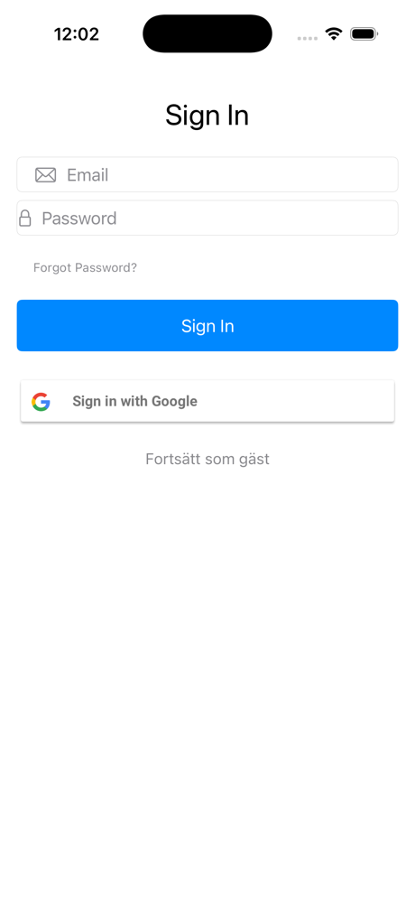
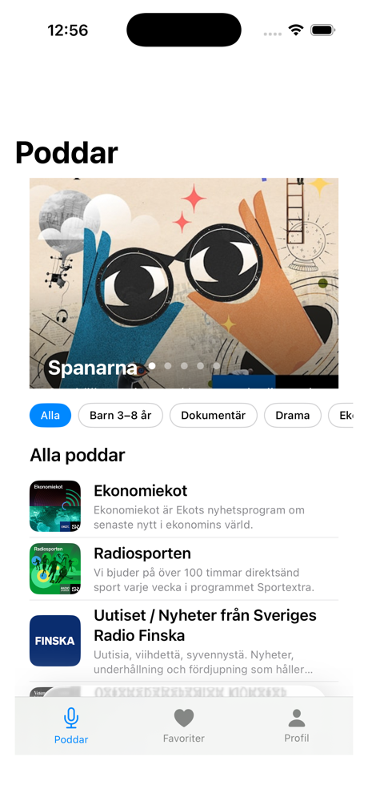
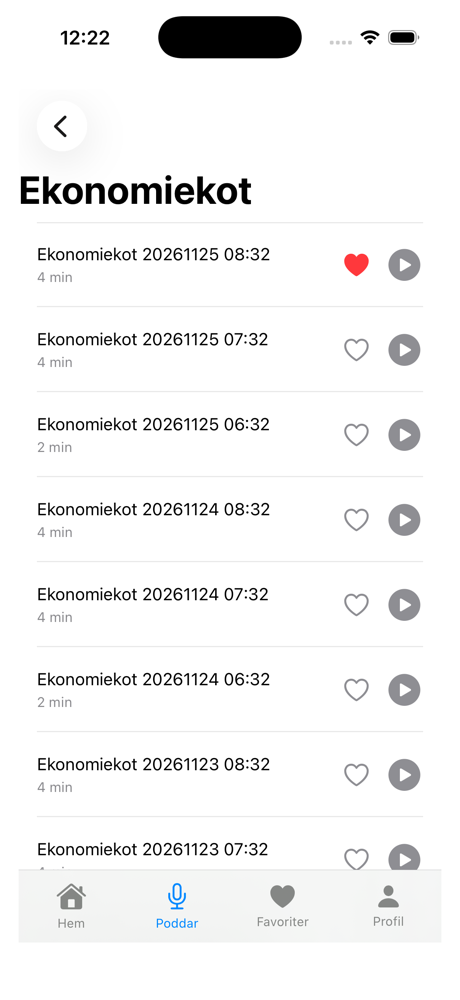
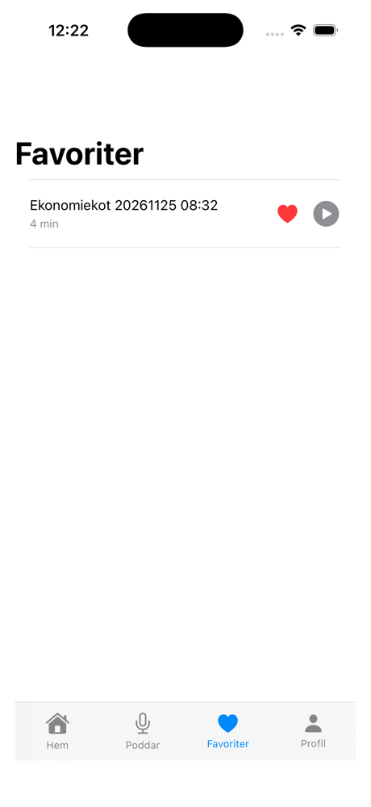
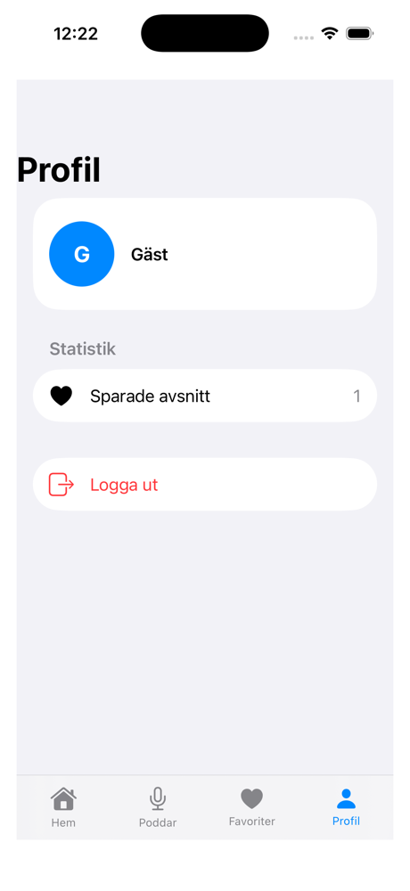
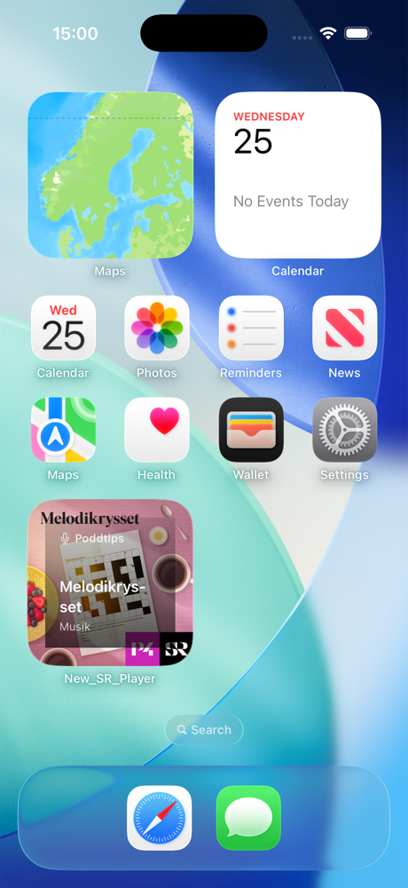

# SR Player

A native iOS app for listening to **Sveriges Radio** (Swedish public radio): podcasts, favorites and a profile. Built with SwiftUI, Swift 6 and the open SR API, with Firebase authentication and on-device language processing.

> Unofficial project. It uses the public [Sveriges Radio open API](https://api.sr.se/api/documentation/v2/index.html) and is not affiliated with Sveriges Radio. The app UI is in Swedish.
>
> All audio, images and program information belong to Sveriges Radio and are used under the [terms of use of the Sveriges Radio open API](https://www.sverigesradio.se/artikel/api-villkor) (in Swedish). This repository contains only the app's source code.
>
> The app only plays podcast episodes, through the links the API provides, and does not offer live channels. This project is an educational demo and is not distributed.

## Screenshots

<p align="center">
  
  
  
</p>
<p align="center">
  
  
  
</p>

## Features

**Podcasts ("Poddar")**
- Swipeable carousel of featured programs and a full program list
- Episode lists with playback and a pulsing ring on the active episode
- Swedish-aware search using `NLTokenizer(.swedish)`, diacritic-insensitive
- Category filter chips built from the API's `programcategory`
- Language badge for non-Swedish programs using `NLLanguageRecognizer` (confidence ≥ 0.70)

**Favorites ("Favoriter")**
- Save episodes with a heart button, persisted locally as JSON in `UserDefaults`

**Account**
- Firebase Auth with email/password, Google Sign-In and anonymous guest mode
- Silent restore of the previous Google session on launch
- Profile page with avatar, name, email, favorites count and sign-out

**Polish**
- Firebase Analytics with typed events (`podcast_episode_play`, `favorite_toggle`, `login`)
- WidgetKit small widget ("Poddtips") showing a random podcast with its image and category, refreshed hourly
- Reusable error banner, tab and list animations, GIF/Lottie splash screen and launch screen

## Tech stack

| Area | Technology |
|---|---|
| UI | SwiftUI, WidgetKit |
| Language | Swift 6, async/await |
| Audio | AVFoundation |
| Auth and analytics | Firebase Auth, Firebase Analytics, GoogleSignIn-iOS |
| On-device AI | Natural Language framework (`NLTokenizer`, `NLLanguageRecognizer`) |
| Animation | Lottie, ImageIO (GIF decoding without extra dependencies) |
| Data | Sveriges Radio open API (REST, JSON) |
| Tests | XCTest with mocked API client and auth |

## Architecture

MVVM with protocol-based dependency injection so view models can be tested without the network or real audio.

```text
New_SR_Player/
├── Model/
│   ├── Login/       # AuthProtocol, UserAuth, LoginModel, Google Sign-In wrapper
│   ├── Player/      # SRAPIClient, API models
│   ├── ViewModel/   # HomeViewModel, PodcastViewModel, PodFileListViewModel
│   └── FavoritesStore.swift
├── Views/           # SwiftUI views (UI only)
└── Helpers/         # Colors, animations, banner, search and language detection, analytics
SRWidget/            # WidgetKit extension ("Poddtips")
New_SR_PlayerTests/  # Unit tests
```

- `SRAPIClientProtocol` is injected into the view models, with a mock in the tests.
- `UserAuth` is the single source of auth state and is injected through `@EnvironmentObject`.
- Views contain only UI; logic lives in the view models.

The full component list and flows are documented in [`CLAUDE.md`](CLAUDE.md) and the history of changes in [`progress.txt`](progress.txt).

## Getting started

**Requirements:** Xcode with the iOS 26 SDK and Swift 6.

1. Clone the repo and open `New_SR_Player.xcodeproj`.
2. Create your own Firebase project and add an iOS app with the bundle identifier you use for the target.
3. In Firebase Console → Authentication, enable the **Email/Password**, **Google** and **Anonymous** providers.
4. Download `GoogleService-Info.plist` and add it to the `New_SR_Player` target in Xcode. The file is ignored by git on purpose and must never be committed.
5. In `New-SR-Player-Info.plist`, set `GIDClientID` and the URL scheme to the values from your own `GoogleService-Info.plist`.
6. Select the `New_SR_Player` scheme and run on a simulator or device.

The SR API needs no key. Read its [terms of use](https://www.sverigesradio.se/artikel/api-villkor) before building on it.

To run the tests, use the `New_SR_Player` scheme and press ⌘U, or run `xcodebuild test` against an iOS simulator.

## Notes

- The Firebase config file and other secrets are excluded through `.gitignore`.
- `LaunchScreen.storyboard` and the splash animation are part of the app entry flow (`SplashPage` → `ContentView`).

## License

Apache-2.0. See [LICENSE](LICENSE) and [NOTICE](NOTICE).
